<p align="center">
  
</p>

<p align="center">
  <a href="https://github.com/pbosetti/complot/actions/workflows/ci.yml"></a>
  <a href="https://github.com/pbosetti/complot/actions/workflows/release.yml"></a>
  <a href="https://github.com/pbosetti/complot/releases/latest"></a>
  <a href="https://www.rust-lang.org"></a>
  <a href="https://github.com/emilk/egui"></a>
  
  <a href="#license"></a>
</p>

Real-time plots driven from the shell, loosely inspired by the grammar of
graphics. Every plot is its own window (a small GUI process); short-lived
`complot` calls push data to it by name.

```sh
h=$(complot --aes "x=t y=temp g=sensor")   # open a window, keep its handle
complot $h log.csv                          # push a CSV chunk
complot $h -x 3.2 -y 21.5 -g kitchen        # push a single point
tail -f log.csv | complot $h -              # stream stdin, live
complot $h --close
```

## Install

| Platform | Command |
|---|---|
| macOS, Linux (Homebrew) | `brew install pbosetti/mads/complot` |
| Debian, Ubuntu | download the `.deb` from the [releases](https://github.com/pbosetti/complot/releases), then `sudo apt install ./complot_*.deb` |
| Windows | `winget install pbosetti.complot` |
| From source | `cargo install --git https://github.com/pbosetti/complot` |

Archives for every platform are on the releases page too. `complot -V` prints
the version; `complot --version` adds the build target.

## Usage

```
complot [NAME] [FILES...] [--aes SPEC] [-x X] [-y Y] [-z Z] [-g GROUP]
        [-t TYPE] [--create] [--clear] [--close] [--title TEXT]
complot [SHARED...] NAME: [ARGS...] [NAME: [ARGS...]]...
complot --by COL [--create] [OPTIONS] FILES...
complot --list
complot --list-types
complot --close-all
```

| Invocation | Effect |
|---|---|
| `complot` | Opens a new plot with an automatic name (`plot1`, …) and prints it. |
| `complot NAME` | Opens plot `NAME` (or reconfigures it if already open) and prints `NAME`. |
| `complot NAME -y V [-x V] [-z V] [-g G]` | Pushes one point. Without `-x`, x is the series' sample index. |
| `-t TYPE` / `--type` | Sets the plot type of the whole plot, or with `-g G` of group G only (see below). |
| `complot NAME FILE...` | Pushes CSV files; `-` streams stdin line by line. |
| `--aes "x=c1 y=c2 g=c3"` | Sets the aesthetic mapping; it is kept by the plot for later chunks. |
| `--create` / `-c` | Opens the plot if needed when pushing data. |
| `--clear`, `--close`, `--title T` | Clears the data, closes the window, sets the title. |
| `NAME: … NAME: …` | Several plots in one call (see below). |
| `--by COL` | Sends each CSV row to the plot named in column COL (see below). |
| `--list` / `-l` | Lists the open plots. |
| `--list-types` | Lists the plot types. |
| `--close-all` | Closes every open plot. |

Pushing data to a plot that is not open is an error (exit status 1), so a
loop stops when you close its window:

```sh
h=$(complot)
while sleep 0.2; do complot $h -y $RANDOM || break; done
```

## Several plots at once

Put a colon after a plot name to start its part of the command line. Options
and files before the first `NAME:` are shared by every plot; a plot's own
options override them. With `NAME:` parts, every other positional is a file.

```sh
complot -x $t temp: -y $T pres: -y $P              # a shared x, a y for each plot
complot temp: a.csv pres: b.csv                    # a file for each plot
tail -f log.csv | complot - temp: --aes "x=t y=temp" \
                            pres: --aes "x=t y=pres"
```

The last line reads the stream once and sends it to both plots; each plot
picks its own columns with its own aesthetic. Without any `NAME:`, the command
line works as before (`complot temp -y 1`).

`--by COL` routes rows instead: each CSV row goes to the plot named by its
value in column COL (a header name or a 1-based index), and that column is left
out of the forwarded row. Each plot gets the chunk's header first.

```sh
sensor_log | complot --by sensor --create --aes "x=t y=v" -
while sleep 0.1; do
  echo "cpu,$(date +%s),$(cpu_load)"
  echo "mem,$(date +%s),$(mem_used)"
done | complot --by 1 --create -                    # one process for the whole loop
```

With `--create`, a plot is opened the first time its name appears, with the
other options of the command line (aesthetic, type, title). Without it,
naming a plot that is not open is an error and its rows are skipped. A plot
whose window is closed during the stream is not reopened.

## Aesthetics

`--aes` takes whitespace-separated `key=column` pairs:

- `x`: x position. If unmapped, x is the row index of each series.
- `y`: y position; a comma-separated list (`y=a,b,c`) plots one series per
  column.
- `g` (also `group`, `color`): grouping column; each distinct value is a series
  with its own colour.
- `z`: depth, for 3D plots.

Columns are referenced by header name, or by 1-based index when no header name
matches (`x=1 y=3`). Without an aesthetic, column 1 is x and every other column
is a y series.

## Plot types

| Type | Draws |
|---|---|
| `point` | points only |
| `lines` | lines only |
| `both` | lines and points (the default) |
| `hist` | a histogram of y, one colour per group |
| `3dl` | 3D lines (needs x, y and z) |
| `3dp` | 3D points and point clouds (needs x, y and z) |

`-t` restyles data already in the plot as well as what comes next: the data is
stored once and the type only changes how it is drawn, so switching back and
forth loses nothing. Without `-g` it applies to every series; with `-g G` only
to group G, even before G's first point arrives. The side panel changes the same
settings, and the last change wins.

`hist` always applies to the whole plot, since a histogram's axes (value and
count) can't be shared with x–y series. All groups share the same bins, by
Sturges' rule unless the panel switches to Scott's; the panel also chooses
between side-by-side and stacked bars. With a buffer limit, the histogram
covers a rolling window of the latest values.

A plot can only switch to `3dl` or `3dp` when every series has z values, and a
3D plot refuses points without z. In 2D and 3D alike, lines and points are
chosen per group:

```sh
h=$(complot -t 3dl --aes "x=x y=y z=z g=body")
complot $h orbit.csv
complot $h -g dust -t 3dp            # this group as a point cloud
```

## CSV chunks

Each file (or stdin stream) is a chunk. The separator is detected on the first
line (`,`, tab, `;`, then whitespace) and `#` lines are comments. The first
line is a header if none of its fields is a number; a chunk without a header
reuses the last header the plot has seen. Missing values (`""`, `NA`, `NaN`,
`null`) are skipped. Quoted fields with embedded separators are not supported.

## The window

Drag or scroll to pan, Ctrl/⌘+scroll or pinch to zoom, right-drag to
box-zoom, double-click to fit. The side panel (collapsible with ⏴) holds the
few graphical settings:

- **Kind**: x–y, histogram or 3D (3D is greyed out until every series has z).
- **All series** and **Series**: the geometry of every series at once, or of
  each one (points, lines, both), plus point size and line width.
- **Histogram**: Sturges or Scott bins, side-by-side or stacked bars.
- **3D**: perspective on or off, reset view. Drag rotates, scroll zooms,
  double-click resets; a click on a legend entry hides its series.
- **Scale**: log x, log y and, in 3D, log z. Ticks sit at the decades and read
  as values (1, 10, 100, 1e5). In a histogram, log x bins the logarithm of the
  values and log y puts the counts on a log axis. Values ≤ 0 can't be shown on
  a log axis; they are left out and counted in the status line.
- Legend, grid, follow (auto-fit while data arrives), a per-series buffer
  limit for rolling windows, clearing the data and copying it as CSV.

Large series (over 5,000 points) are decimated for drawing only; the stored
data stays complete. Lines keep the first, last, minimum and maximum point of
every pixel column, so peaks are never lost; markers keep one point per
marker-sized screen cell. A million points draw in about 130 MB. A large
series whose x values are not increasing is drawn as points even in line mode,
since its line cannot be decimated. 3D series are thinned the same way after
projection, so a million-point cloud draws in about 140 MB too. The status line
says when decimation is active (`drawing N of M`).

## Build

```sh
cargo build --release   # binary: target/release/complot
```

The version comes from the nearest `vX.Y.Z` git tag (`0.2.0`, or
`0.2.0-3-gabc1234` three commits later, `-dirty` with local changes), or from
Cargo.toml when there is no tag or no git; `COMPLOT_VERSION=1.2.3` at build
time overrides it.

Plots are registered in a per-user directory (`$XDG_RUNTIME_DIR` or the
system temp dir, under `complot-$USER`; override with `COMPLOT_DIR`), which
also holds each plot's log. Clients talk to plots over TCP on 127.0.0.1,
authenticated with a per-plot random token.

## License

Licensed under either of [MIT](LICENSE-MIT) or [Apache-2.0](LICENSE-APACHE), at
your option.

The banner is drawn from real data (a Lorenz trajectory, Gaussian samples) by
[`assets/make_banner.py`](assets/make_banner.py).
